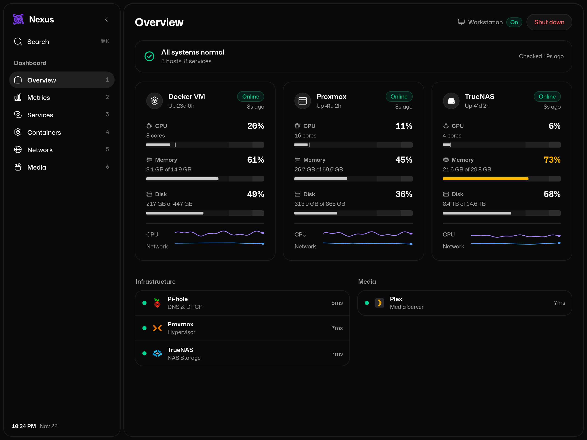
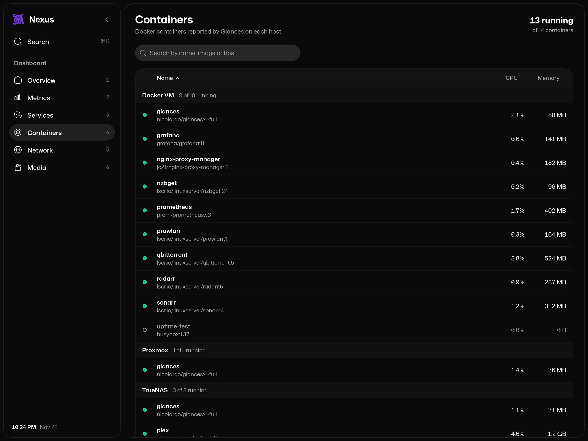
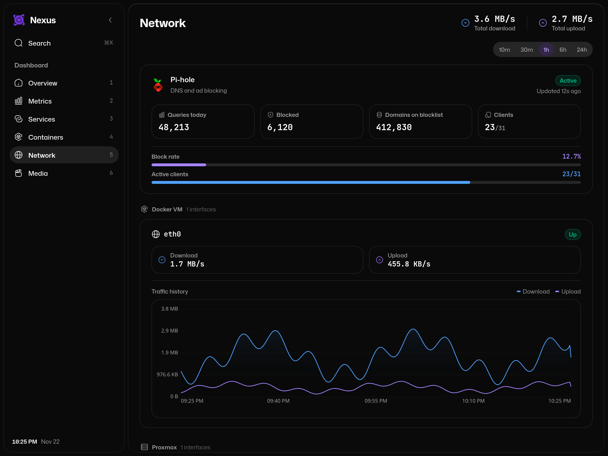

# Nexus

A homelab dashboard built with Svelte 5 and Express 5. Monitors host resources via Glances, tracks service uptime, displays Docker containers, network traffic, and media stack stats.



## Architecture


A UML component diagram. The SVG embeds its draw.io source, so open `docs/architecture.drawio.svg` in [draw.io](https://www.drawio.com) to edit it.

**Key design decisions:**

- **Server-side API proxying** — API keys and session tokens never reach the
  browser. The Express server authenticates with each upstream service and
  forwards sanitized JSON.
- **Inline SVG icons** — All UI chrome icons are bundled as raw SVG paths in
  `Icon.svelte`, eliminating ~40 external CDN requests per page load. Service
  icons (sonarr, radarr, etc.) still use jsdelivr CDN since they're
  user-configured.
- **No build step for the server** — Node runs the server's TypeScript directly
  with its built-in type stripping (Node 22.18 or newer). Vite only builds the
  client SPA to `dist/`.

## Features

- **Host metrics** — CPU, memory, disk, and uptime from Glances API endpoints
- **Service monitoring** — the server checks every service every 30s (5xx or no response = down) and keeps the last 30 results for the heartbeat strip and latency sparkline
- **Container overview** — Docker containers across all hosts with CPU/memory stats
- **Network traffic** — per-interface bandwidth with sparkline history charts
- **Pi-hole stats** — DNS query stats via server-side proxy
- **Media stack** — qBittorrent, NZBGet, Sonarr, Radarr, Prowlarr stats via server-side proxy
- **Wake-on-LAN** — wake one configured machine with a UDP magic packet; Pi-hole provides its online status and its IP for SSH shutdown
- **Video downloader** — Live progress from a self-hosted video downloader's status API
- **Status at a glance** — the Overview opens with one sentence naming anything that's down; stale data is kept but marked with its age
- **Keyboard** — `⌘K`/`Ctrl+K` or `/` searches pages, services, containers and power actions, `1`–`6` jump to pages; ranges, sorts and searches live in the URL
- **Dark theme** — OKLCH tokens with separate status (`--ok/--warn/--crit`) and data-series colors; override `--text-*` on `:root` to scale the UI for a wall display

## Screenshots

| Containers | Network |
|---|---|
|  |  |

## Quick Start

```yaml
services:
  nexus:
    build: .
    env_file: .env
    ports:
      - "3000:3000"
    volumes:
      - ./config:/config:ro
    restart: unless-stopped
```

Put a `config.json` in `./config` (see [examples/config.json](examples/config.json)) and create a `.env` file with the credentials for the services you use. Wake-on-LAN also needs `network_mode: host` so the magic packet reaches your LAN; see [Wake-on-LAN and shutdown](#wake-on-lan-and-shutdown).

## Configuration

Nexus loads its dashboard configuration from a JSON file mounted at `/config/config.json` (override with `CONFIG_PATH` env var).

```json
{
  "services": [
    {
      "section": "Infrastructure",
      "items": [
        { "name": "Pi-hole", "icon": "pi-hole", "href": "https://pihole.example.com", "desc": "DNS & DHCP" }
      ]
    }
  ],
  "hosts": [
    { "name": "Docker VM", "key": "docker", "url": "https://glances-docker.example.com" }
  ],
  "overview_services": ["Pi-hole", "Plex"]
}
```

| Field | Description |
|---|---|
| `services` | Service groups shown on the Services page. `icon` can be a short name (resolved from [dashboard-icons](https://github.com/walkxcode/dashboard-icons)) or a full URL |
| `hosts` | Glances hosts to monitor. `key` is used internally, `url` is the Glances API base URL. Optional `interface` pins the network interface shown on the Overview and Network pages. A host keyed `docker` is left out of the Network page's totals |
| `overview_services` | Service names to show on the Overview page (subset of services). Omit to show all |
| `wol` | Optional. One machine to wake and shut down; see [Wake-on-LAN and shutdown](#wake-on-lan-and-shutdown) |

## Environment Variables

All optional: a service whose URL is unset is skipped. Pass them with `env_file` or `environment` in compose; `npm run start` also reads a local `.env`.

| Variable | Description |
|---|---|
| `PIHOLE_URL` | Pi-hole API URL |
| `PIHOLE_PASSWORD` | Pi-hole admin password |
| `QBIT_URL` | qBittorrent web UI URL |
| `HOMEPAGE_VAR_QBIT_USER` | qBittorrent username |
| `HOMEPAGE_VAR_QBIT_PASS` | qBittorrent password |
| `NZBGET_URL` | NZBGet URL |
| `HOMEPAGE_VAR_NZBGET_USER` | NZBGet username |
| `HOMEPAGE_VAR_NZBGET_PASS` | NZBGet password |
| `SONARR_URL` | Sonarr URL |
| `HOMEPAGE_VAR_SONARR_KEY` | Sonarr API key |
| `RADARR_URL` | Radarr URL |
| `HOMEPAGE_VAR_RADARR_KEY` | Radarr API key |
| `PROWLARR_URL` | Prowlarr URL |
| `HOMEPAGE_VAR_PROWLARR_KEY` | Prowlarr API key |
| `VIDEO_DL_1_URL` | Video downloader API URL |
| `CONFIG_PATH` | Config file path (default: `/config/config.json`) |
| `PORT` | Server port (default `3000`) |
| `LOG_LEVEL` | `debug`, `info`, `warn` or `error` (default `info`) |
| `TZ` | Time zone for log timestamps (default `UTC`) |
| `NEXUS_API_TOKEN` | Required for wake and shutdown. `POST /api/wol/wake` and `/api/wol/shutdown` need a matching `X-Nexus-Token` header (the UI asks once and stores it in localStorage). Unset, both endpoints answer `503` and stay disabled |

## Wake-on-LAN and shutdown

Add a `wol` block to `config.json`:

```json
"wol": { "name": "My PC", "hostname": "my-pc.lan", "mac": "AA:BB:CC:DD:EE:FF", "ssh_user": "admin" }
```

| Field | Description |
|---|---|
| `mac` | Required. The machine's MAC address. It is also how Nexus finds the machine in Pi-hole's network table |
| `hostname` | The name Pi-hole knows the machine by, used to pick its IP for shutdown |
| `name` | Label shown in the UI (defaults to `hostname`) |
| `broadcast` | Broadcast address for the magic packet (default `255.255.255.255`) |
| `ssh_user` | Enables Shut down, which runs `shutdown /s /full /f /t 0` over SSH, so the target must be Windows with OpenSSH Server |

- Wake and shutdown stay disabled until `NEXUS_API_TOKEN` is set.
- The machine counts as online if Pi-hole saw a DNS query from it in the last 5 minutes.
- Shutdown uses the private key at `/config/ssh_key`. The container runs as UID 1000, so make the key readable by that user: `chown 1000:1000 config/ssh_key && chmod 600 config/ssh_key`.
- The magic packet is a LAN broadcast, so run the container with `network_mode: host`.

## Project Structure

```
nexus/
├── server/                 # Express API server (TypeScript, run by Node directly)
│   ├── index.ts            # Entry point, mounts middleware
│   ├── glances-proxy.ts    # Proxies Glances API per host
│   ├── pihole-proxy.ts     # Pi-hole v6 auth + stats
│   ├── media-proxy.ts      # qBit, NZBGet, Sonarr, Radarr, Prowlarr aggregate
│   ├── video-dl-proxy.ts   # Custom video downloader status
│   ├── wol.ts              # Wake-on-LAN magic packet, Pi-hole status, SSH shutdown
│   ├── status.ts           # Server-side service checks + history (/api/status)
│   ├── status.test.ts      # Tests for the up/down rule
│   ├── http.ts             # Shared fetch timeout, TTL cache, JSON endpoint helper
│   └── log.ts              # Structured logger
├── src/
│   ├── App.svelte          # Root component, routing, data fetching
│   ├── app.css             # Design tokens (OKLCH), global styles
│   ├── lib/
│   │   ├── components/     # Reusable Svelte 5 components
│   │   ├── pages.ts        # Pages for the sidebar, palette and 1–6 shortcuts
│   │   ├── types.ts        # Shared TypeScript interfaces, service-icon CDN base
│   │   └── utils/          # Formatting, polling, hash-URL state, canvas chart helpers
│   └── pages/              # Page-level components (one per route)
├── docs/                   # Architecture diagram (draw.io SVG) and screenshots
├── Dockerfile              # Multi-stage: build the client, run the server as the node user
├── vite.config.ts          # Svelte plugin; forwards /api to :3000 in development
├── LICENSE
└── package.json
```

## Development

Run the API server and the Vite dev server side by side:

```bash
npm install
CONFIG_PATH=./config/config.json npm run start   # API server on :3000
npm run dev                                      # Vite on :5173, forwards /api to :3000
```

## Production

```bash
npm run build        # Build client SPA to dist/
npm run start        # Start Express server on :3000
```

## Scripts

| Script         | Description                          |
| -------------- | ------------------------------------ |
| `dev`          | Vite dev server with HMR             |
| `build`        | Production client build              |
| `start`        | Run the Express server                |
| `check`        | Svelte type checking                 |
| `check:server` | Server TypeScript type checking      |
| `lint`         | ESLint (Svelte + TypeScript)         |
| `test`         | Server tests (Node's test runner)    |

## Credits

- The colour palette and floating layout are adapted from [Arcane](https://github.com/getarcaneapp/arcane) (BSD-3-Clause).
- Service icons come from [dashboard-icons](https://github.com/walkxcode/dashboard-icons), loaded from jsDelivr.

## License

[MIT](LICENSE)
