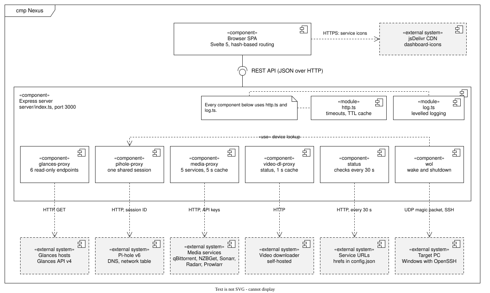

# Nexus

A self-hosted homelab dashboard for Glances hosts, service uptime, Docker containers, Pi-hole and the \*arr stack.


Nexus is a Svelte 5 single-page app served by a small Express 5 server written in TypeScript. The browser only talks to that server. The server calls Glances, Pi-hole and your media services itself, so passwords and API keys never reach the browser.

I built Nexus for my own homelab and published it to show how it works, not as a maintained product.

You configure Nexus with one JSON file and a few environment variables. There is no database and no plugin system: the integrations listed below are the ones it has.

## Contents

- [Features](#features)
- [Screenshots](#screenshots)
- [How it works](#how-it-works)
- [Security](#security)
- [Limitations](#limitations)
- [Requirements](#requirements)
- [Quick start](#quick-start)
- [Updating](#updating)
- [Configuration](#configuration)
- [Wake-on-LAN and shutdown](#wake-on-lan-and-shutdown)
- [Troubleshooting](#troubleshooting)
- [FAQ](#faq)
- [Development](#development)
- [Forking](#forking)
- [Credits](#credits)
- [License](#license)

## Features

- **Overview.** One status line names whatever is down and for how long. Below it are cards for each host (CPU, memory, disk, uptime, CPU and network sparklines) and the services you choose.
- **Host metrics.** CPU history per host, split into user and system, over 1 h, 6 h, 12 h or 24 h.
- **Service checks.** The server requests every service URL every 30 seconds. A 5xx response or no answer within 5 seconds counts as down. Each service shows its last 30 checks and a latency sparkline.
- **Containers.** Docker containers from every host's Glances, grouped by host, with CPU and memory. Search by name, image or host, and sort by CPU or memory.
- **Network.** Receive and transmit history per interface, from 10 minutes to 24 hours, and Pi-hole v6 query stats.
- **Media.** qBittorrent and NZBGet transfers, Sonarr and Radarr queues and missing counts, Prowlarr indexer totals, and the status of a self-hosted video downloader.
- **Wake-on-LAN and shutdown.** Wake one PC with a magic packet and shut it down over SSH. Both stay off until you set an API token.
- **Keyboard and URLs.** `⌘K`, `Ctrl+K` or `/` opens a search over pages, services, containers and power actions. Keys `1` to `6` switch pages. Ranges, sorts and searches are kept in the URL, so you can bookmark a view.
- **Stale data stays visible.** If a host stops answering, its last values stay on screen, marked with their age.
- **Phone layout.** On narrow screens the sidebar becomes a bottom tab bar.

## Screenshots

| Containers | Network |
|---|---|
|  |  |

## How it works



The browser polls the Nexus server, and the server calls each upstream system. The SVG embeds its draw.io source, so you can open `docs/architecture.drawio.svg` in [draw.io](https://www.drawio.com) to edit it.

Design decisions:

- **Server-side proxying.** The browser talks to one origin. The server logs in to each upstream service and reshapes its response to the fields the UI needs, which also keeps the client code free of each service's API quirks.
- **Shared upstream sessions and short caches.** Pi-hole and qBittorrent each get one shared login. Pi-hole and media stats are cached for 5 seconds, so several open dashboards make one set of upstream requests. After a failed qBittorrent login, Nexus waits 60 seconds before it tries again, because repeated failures make qBittorrent ban the client's IP.
- **Inline SVG icons.** The interface's own icons are SVG paths in `Icon.svelte`, so the UI needs no icon CDN. Service icons still come from jsDelivr because you choose them in `config.json`.
- **No build step for the server.** Node runs the server's TypeScript directly with its built-in type stripping (Node 22.18 or newer). Vite only builds the client to `dist/`.

The browser uses these endpoints:

| Method | Path | Returns |
|---|---|---|
| GET | `/api/config` | Hosts, services and the Wake-on-LAN label, without internal details |
| GET | `/api/status` | The last 30 checks for each service URL, and when a current outage began |
| GET | `/api/glances/<key>/api/4/<endpoint>` | Glances data for one host, for the allowed endpoints listed under [Security](#security) |
| GET | `/api/pihole/stats` | Pi-hole summary stats |
| GET | `/api/media/stats` | Stats for each media service, or an `error` for each one that failed or is not configured |
| GET | `/api/video-dl` | Video downloader status |
| GET | `/api/wol/status` | `{ "name": ..., "online": ... }` |
| POST | `/api/wol/wake` | Sends the magic packet. Needs `X-Nexus-Token`. |
| POST | `/api/wol/shutdown` | Runs the SSH shutdown. Needs `X-Nexus-Token`. |

The `/api/wol/*` endpoints exist only when `config.json` has a valid `wol` block.

## Security

- **There is no login.** Anyone who can reach Nexus can see your hosts, containers, download queues and Pi-hole stats. Keep it on your LAN or VPN. If it must be reachable from elsewhere, put it behind a reverse proxy that requires authentication and serves HTTPS.
- **Bind to localhost if only a local reverse proxy should reach Nexus.** Publish the port as `"127.0.0.1:3000:3000"` instead of `"3000:3000"`. With `network_mode: host` this does not apply: Nexus listens on all interfaces, so use a firewall.
- **What the browser receives.** `/api/config` sends only what the UI displays: host names and keys, service links and icons, and the Wake-on-LAN name and hostname. Glances URLs, the MAC address, the SSH user and every password or API key stay server-side.
- **The Glances proxy is read-only.** It forwards GET requests for `cpu`, `mem`, `fs`, `network`, `uptime` and `containers` (and their `/history`) and refuses everything else. It does not follow redirects.
- **Wake and shutdown need a token.** Both stay disabled until `NEXUS_API_TOKEN` is set. The browser stores the token in local storage and sends it in a header, so serve Nexus over HTTPS if the token crosses a network you do not trust.
- **The container does not run as root.** It runs as the image's `node` user (UID 1000).
- **Third-party requests.** The browser loads fonts from Google Fonts and service icons from jsDelivr. Everything else comes from your Nexus server.

## Limitations

Check these before you run it yourself.

- **No login.** See [Security](#security) for how to keep it private.
- **Glances 4 only.** Nexus calls the Glances REST API v4 (`/api/4`). Glances 5 moves it to `/api/5`, which Nexus does not call.
- **One Wake-on-LAN machine.** Shutdown only works on Windows with OpenSSH Server.
- **Fixed integrations.** Adding a service means writing a server module and a Svelte component.
- **Short history.** The server keeps the last 30 checks per service (15 minutes) in memory and loses them on restart. Charts show the history Glances keeps plus what the open tab has collected.
- **Dark theme and English only.**
- **No published image.** You build the Docker image from this repository.

## Requirements

- Docker with Compose v2, or Node.js 22.18 or newer to run without Docker.
- [Glances](https://github.com/nicolargo/glances) 4 in web server mode (`glances -w`, port 61208 by default) on each host you want to see. Nexus must be able to reach it without a password. For the Containers page, Glances needs access to the Docker socket.
- Optional, each one on its own:
  - Pi-hole v6 (the v5 API is not supported)
  - qBittorrent 4 or 5
  - NZBGet
  - Sonarr and Radarr (API v3)
  - Prowlarr (API v1)

Leave a service out and its panel says it is not configured.

## Quick start

1. Clone the repository and create a config directory and an empty `.env`:

   ```bash
   git clone https://github.com/Danial-Changez/Nexus.git nexus
   cd nexus
   mkdir config
   cp examples/config.json config/config.json
   touch .env
   ```

2. Edit `config/config.json`. List your Glances hosts under `hosts` and your links under `services`. Delete the `wol` block unless you plan to set up [Wake-on-LAN](#wake-on-lan-and-shutdown). The fields are described in [config.json](#configjson).

3. Add the URLs and credentials of the services you use to `.env`. See [Environment variables](#environment-variables) for an example.

4. Create `compose.yaml` in the same directory:

   ```yaml
   services:
     nexus:
       build: .
       env_file: .env
       ports:
         - "3000:3000"
       volumes:
         - ./config:/config:ro
       restart: unless-stopped
   ```

5. Build and start it:

   ```bash
   docker compose up -d --build
   ```

Nexus is now running on port 3000, for example `http://localhost:3000` or `http://<server-ip>:3000`.

Check the log with `docker compose logs nexus`. At startup Nexus prints how many hosts and services it loaded, which media services it is skipping, and how many service URLs it will check.

## Updating

```bash
git pull
docker compose up -d --build
```

Your `config/` directory and `.env` are not part of the repository, so `git pull` leaves them alone.

## Configuration

Nexus reads two things at startup: `config.json` for what to show, and environment variables for where your services are and how to log in to them. Restart Nexus after changing either one:

```bash
docker compose restart nexus
```

### config.json

Nexus reads `/config/config.json`. Set `CONFIG_PATH` to use another path. If the file is missing or is not valid JSON, Nexus logs a warning and starts with an empty dashboard.

A shortened example (the full one is in [examples/config.json](examples/config.json)):

```json
{
  "services": [
    {
      "section": "Infrastructure",
      "items": [
        { "name": "Pi-hole", "icon": "pi-hole", "href": "https://pihole.example.com", "desc": "DNS & DHCP" }
      ]
    }
  ],
  "hosts": [
    { "name": "Docker VM", "key": "docker", "url": "https://glances-docker.example.com" }
  ],
  "overview_services": ["Pi-hole"]
}
```

| Field | Description |
|---|---|
| `services` | Groups of links shown on the Services page. Each group has a `section` heading and a list of `items`. |
| `hosts` | Glances hosts to monitor. |
| `overview_services` | Service names to show on the Overview page. Omit it, or leave it empty, to show all services. |
| `wol` | Optional. One machine to wake and shut down. See [Wake-on-LAN and shutdown](#wake-on-lan-and-shutdown). |

Each item in a `services` group:

| Field | Description |
|---|---|
| `name` | Label. `overview_services` refers to services by this name. |
| `icon` | A [dashboard-icons](https://github.com/homarr-labs/dashboard-icons) name such as `sonarr`, or a full URL starting with `http`. |
| `href` | The link. It is also the URL the server checks every 30 seconds. |
| `desc` | Short text shown under the name. |

Each entry in `hosts`:

| Field | Description |
|---|---|
| `name` | Label. |
| `key` | Short ID used in API paths. The keys `docker`, `proxmox` and `truenas` get their own icons; any other key gets a generic server icon. A host keyed `docker` is left out of the Network page's total, on the assumption that it is a VM whose traffic its hypervisor already counts. |
| `url` | Glances base URL without `/api/4`, for example `http://192.168.1.10:61208`. Nexus does not follow redirects, so use the final URL. |
| `interface` | Optional. Pins the network interface shown for this host. Without it, the Overview shows the busiest interface that is not loopback, a Docker bridge or a veth pair, and the Network page shows every interface except `lo`. |

### Environment variables

All are optional. A service whose URL is unset is skipped. Pass them with `env_file` or `environment` in Compose. `npm run start` also reads a `.env` file in the current directory.

For every `*_URL`, give the base URL of the service. Nexus adds the API path itself.

| Variable | Description |
|---|---|
| `PIHOLE_URL` | Pi-hole base URL, without `/admin` or `/api` |
| `PIHOLE_PASSWORD` | Pi-hole admin password |
| `QBIT_URL` | qBittorrent web UI URL |
| `HOMEPAGE_VAR_QBIT_USER` | qBittorrent username |
| `HOMEPAGE_VAR_QBIT_PASS` | qBittorrent password |
| `NZBGET_URL` | NZBGet URL |
| `HOMEPAGE_VAR_NZBGET_USER` | NZBGet username |
| `HOMEPAGE_VAR_NZBGET_PASS` | NZBGet password |
| `SONARR_URL` | Sonarr URL |
| `HOMEPAGE_VAR_SONARR_KEY` | Sonarr API key |
| `RADARR_URL` | Radarr URL |
| `HOMEPAGE_VAR_RADARR_KEY` | Radarr API key |
| `PROWLARR_URL` | Prowlarr URL |
| `HOMEPAGE_VAR_PROWLARR_KEY` | Prowlarr API key |
| `VIDEO_DL_1_URL` | Video downloader API URL. See [the FAQ](#faq). |
| `NEXUS_API_TOKEN` | Required for wake and shutdown. Unset, both actions answer `503` and stay disabled. |
| `CONFIG_PATH` | Config file path (default `/config/config.json`) |
| `PORT` | Server port (default `3000`) |
| `LOG_LEVEL` | `debug`, `info`, `warn` or `error` (default `info`) |
| `TZ` | Time zone for log timestamps (default `UTC`) |

An example `.env`. The addresses use each service's default port; change them to match yours.

```dotenv
PIHOLE_URL=http://192.168.1.2
PIHOLE_PASSWORD=change-me

QBIT_URL=http://192.168.1.20:8080
HOMEPAGE_VAR_QBIT_USER=admin
HOMEPAGE_VAR_QBIT_PASS=change-me

NZBGET_URL=http://192.168.1.20:6789
HOMEPAGE_VAR_NZBGET_USER=nzbget
HOMEPAGE_VAR_NZBGET_PASS=change-me

SONARR_URL=http://192.168.1.20:8989
HOMEPAGE_VAR_SONARR_KEY=your-sonarr-api-key
RADARR_URL=http://192.168.1.20:7878
HOMEPAGE_VAR_RADARR_KEY=your-radarr-api-key
PROWLARR_URL=http://192.168.1.20:9696
HOMEPAGE_VAR_PROWLARR_KEY=your-prowlarr-api-key
```

## Wake-on-LAN and shutdown

Nexus can wake one machine and, if it runs Windows, shut it down. The controls appear at the top of the Overview page and in the `⌘K` search.

### Set up waking

1. Turn on Wake-on-LAN in the machine's firmware and network adapter settings.
2. Add a `wol` block to `config.json`:

   ```json
   "wol": { "name": "My PC", "hostname": "my-pc.lan", "mac": "AA:BB:CC:DD:EE:FF" }
   ```

3. Set `NEXUS_API_TOKEN` in `.env` to a long random string, for example the output of `openssl rand -hex 32`.
4. Run the container on the host network so the magic packet reaches your LAN. Replace `ports` with `network_mode: host`:

   ```yaml
   services:
     nexus:
       build: .
       env_file: .env
       network_mode: host
       volumes:
         - ./config:/config:ro
       restart: unless-stopped
   ```

   Nexus then listens on port 3000 of the host itself (or on `PORT`).

The first time you press Wake or Shut down, the browser asks for the token and keeps it in local storage. It is sent in the `X-Nexus-Token` header.

| Field | Description |
|---|---|
| `mac` | Required. The machine's MAC address, as `AA:BB:CC:DD:EE:FF` or `AA-BB-CC-DD-EE-FF`. Nexus also uses it to find the machine in Pi-hole's network table. If it is missing or malformed, Wake-on-LAN is disabled and the log says why. |
| `hostname` | The name Pi-hole knows the machine by. Used to pick its IP address for shutdown. |
| `name` | Label shown in the UI. Defaults to `hostname`. |
| `broadcast` | Broadcast address for the magic packet. Default `255.255.255.255`. Nexus sends to this address and to `255.255.255.255`, on UDP port 9. |
| `ssh_user` | Needed for Shut down. Without it, a shutdown request fails with `No ssh_user configured`. |

### On or off

Nexus asks Pi-hole whether the machine sent a DNS query in the last 5 minutes. If it did, the machine counts as on. This needs `PIHOLE_URL` to be set and the machine to use Pi-hole for DNS. Without Pi-hole, Wake still works, but Nexus always shows the machine as off and cannot shut it down.

After a wake, Nexus waits up to 3 minutes for the machine to come online and tells you if it does not.

### Set up shutdown

Shut down runs `shutdown /s /full /f /t 0` on the machine over SSH. `/f` closes open programs without asking, so unsaved work is lost. The button asks for a second click within 5 seconds before it sends anything.

1. Install and start OpenSSH Server on the Windows machine.
2. Create a key pair without a passphrase in `config/`. Nexus always reads the private key from `/config/ssh_key`, and the container runs as UID 1000, so that user must be able to read it:

   ```bash
   ssh-keygen -t ed25519 -N "" -C nexus -f config/ssh_key
   chmod 600 config/ssh_key
   sudo chown 1000:1000 config/ssh_key
   ```

3. Add the contents of `config/ssh_key.pub` to the account's `C:\Users\<user>\.ssh\authorized_keys`. For an administrator account, Windows OpenSSH reads `C:\ProgramData\ssh\administrators_authorized_keys` instead.
4. Set `ssh_user` in the `wol` block and restart Nexus.

Nexus looks up the machine's current IPv4 address in Pi-hole by its MAC address, not by hostname, because any device on the LAN can claim a hostname. It accepts the machine's SSH host key the first time it connects (`StrictHostKeyChecking=accept-new`) and stores it inside the container, so a recreated container trusts the first key it sees again.

## Troubleshooting

Set `LOG_LEVEL=debug` in `.env`, restart, and follow the log with `docker compose logs -f nexus`. At debug level Nexus logs every Glances request with its status code.

<details>
<summary><strong>A host card says "Unreachable"</strong></summary>

Nexus reaches Glances from inside its container. Test the same request from there:

```bash
docker compose exec nexus wget -qO- http://192.168.1.10:61208/api/4/cpu
```

If that fails, check that Glances 4 is running in web server mode, is reachable from the Nexus host, and has no password. If the URL redirects (for example from `http` to `https`), put the final URL in `config.json`.

</details>

<details>
<summary><strong>The Containers page is empty</strong></summary>

Glances lists containers only when it can reach the Docker socket. If Glances runs in a container, mount `/var/run/docker.sock` into it.

</details>

<details>
<summary><strong>A service shows as down but opens in my browser</strong></summary>

The check runs from the Nexus container, not from your browser. DNS, firewall rules and certificates apply from the container's point of view.

A self-signed or private-CA certificate makes the check fail, because Node rejects certificates it does not trust. Put your CA certificate in `config/` and add `NODE_EXTRA_CA_CERTS=/config/ca.pem` to `.env`.

Only a 5xx response or no answer within 5 seconds counts as down. Redirects and `401` or `403` responses count as up.

</details>

<details>
<summary><strong>A media panel says the credentials were rejected</strong></summary>

Check the variable names in `.env` against the [table above](#environment-variables), then restart Nexus. Environment variables are read only at startup. After a failed qBittorrent login, Nexus waits 60 seconds before it tries again.

</details>

<details>
<summary><strong>Wake works, but the machine always shows as off</strong></summary>

Nexus decides on or off from Pi-hole's network table. The machine must use Pi-hole for DNS, and the `mac` in `config.json` must match the MAC Pi-hole shows for it. Check Pi-hole's Network page.

</details>

<details>
<summary><strong>Shutdown fails with "Permission denied (publickey)"</strong></summary>

Check that `config/ssh_key` is owned by UID 1000 and has mode `600`, that `ssh_user` is right, and that the public key is in the file Windows reads. Administrator accounts use `C:\ProgramData\ssh\administrators_authorized_keys`.

</details>

<details>
<summary><strong>Changes to config.json do not show up</strong></summary>

Nexus reads `config.json` once at startup. Run `docker compose restart nexus`.

</details>

## FAQ

<details>
<summary><strong>Why are some variables named HOMEPAGE_VAR_...?</strong></summary>

The credential variables use the `HOMEPAGE_VAR_` prefix from [Homepage](https://github.com/gethomepage/homepage). If you already run Homepage with variables of the same names, both can read the same `.env`.

</details>

<details>
<summary><strong>What is the video downloader?</strong></summary>

A separate self-hosted service with an HTTP API. Nexus reads `GET /status` and `GET /history` from `VIDEO_DL_1_URL` and shows active downloads and recent attempts on the Media page. Unless you run a service with that API, leave the variable unset; the panel then says it is not configured.

</details>

<details>
<summary><strong>How often does the page refresh?</strong></summary>

Host cards and the Wake-on-LAN status refresh every 10 seconds, and media stats every 15 seconds. Service status, containers, network traffic and Pi-hole stats refresh every 30 seconds. The video downloader panel refreshes every second while the Media page is open. Polling pauses while the tab is hidden and resumes when you come back.

</details>

<details>
<summary><strong>Does Nexus store anything?</strong></summary>

No. There is no database, and Nexus writes no files except SSH's `known_hosts` inside the container. Service check history lives in server memory. The browser keeps the wake/shutdown token in local storage.

</details>

<details>
<summary><strong>Can I make the text larger for a wall display?</strong></summary>

Text sizes come from the `--text-*` variables in `src/app.css`. Change them and rebuild the image.

</details>

<details>
<summary><strong>Can I add another integration?</strong></summary>

Not without code. Each integration is a module in `server/` and a component in `src/`. If you want a dashboard with many integrations ready to use, look at [Homepage](https://github.com/gethomepage/homepage), [Homarr](https://github.com/homarr-labs/homarr) or [Dashy](https://github.com/Lissy93/dashy).

</details>

## Development

You need Node.js 22.18 or newer. Run the API server and the Vite dev server side by side:

```bash
npm install
cp examples/config.json config.json
CONFIG_PATH=./config.json npm run start   # API server on :3000, reads .env if present
npm run dev                               # Vite on :5173, forwards /api to :3000
```

`config.json` and `.env` in the repository root are git-ignored.

To run a production build without Docker:

```bash
npm ci
npm run build
CONFIG_PATH=./config.json npm run start
```

Shutdown outside Docker also needs the `ssh` client on your `PATH` and the key at `/config/ssh_key`. That path is fixed.

### Scripts

| Script | Description |
|---|---|
| `dev` | Vite dev server with hot reload |
| `build` | Production client build to `dist/` |
| `start` | Run the Express server |
| `check` | Svelte and TypeScript checks for the client |
| `check:server` | TypeScript checks for the server |
| `lint` | ESLint (Svelte and TypeScript) |
| `test` | Server tests with Node's test runner |

### Project structure

```
nexus/
├── server/                 # Express API server (TypeScript, run by Node directly)
│   ├── index.ts            # Entry point: loads config, mounts middleware
│   ├── glances-proxy.ts    # Read-only Glances proxy per host
│   ├── pihole-proxy.ts     # Pi-hole v6 login and stats
│   ├── media-proxy.ts      # qBittorrent, NZBGet, Sonarr, Radarr, Prowlarr
│   ├── video-dl-proxy.ts   # Video downloader status
│   ├── wol.ts              # Magic packet, Pi-hole status, SSH shutdown
│   ├── status.ts           # Service checks and history (/api/status)
│   ├── status.test.ts      # Tests for the up/down rule
│   ├── http.ts             # Fetch timeout, TTL cache, JSON endpoint helper
│   └── log.ts              # Levelled logger
├── src/
│   ├── App.svelte          # Root component, routing, data fetching
│   ├── app.css             # Design tokens (OKLCH) and global styles
│   ├── lib/
│   │   ├── components/     # Svelte 5 components
│   │   ├── pages.ts        # Pages for the sidebar, search and 1–6 shortcuts
│   │   ├── types.ts        # Shared types, service-icon CDN base
│   │   └── utils/          # Formatting, polling, URL state, chart helpers
│   └── pages/              # One component per page
├── docs/                   # Architecture diagram (draw.io SVG) and screenshots
├── examples/config.json    # Example configuration
├── Dockerfile              # Builds the client, runs the server as the node user
├── vite.config.ts          # Svelte plugin; forwards /api to :3000 in development
├── LICENSE
└── package.json
```

## Forking

I don't take issues or pull requests for Nexus. To adapt it, fork the repository; it is MIT licensed. These are the checks I run before each commit:

```bash
npm run check && npm run check:server && npm run lint && npm test
```

Commit messages follow [Conventional Commits](https://www.conventionalcommits.org).

## Credits

- The colour palette and floating layout are adapted from [Arcane](https://github.com/getarcaneapp/arcane) (BSD-3-Clause).
- Service icons come from [dashboard-icons](https://github.com/homarr-labs/dashboard-icons) (formerly `walkxcode/dashboard-icons`), loaded from jsDelivr.
- Host and container metrics come from [Glances](https://github.com/nicolargo/glances).

## License

[MIT](LICENSE)
